# Vomix Studio 사용 설명서

짧은 소리 조각(샘플)을 멜로디의 음높이와 길이에 맞춰 연주시키는 **음MAD / YTPMV 제작 도구**의 모든 기능을 순서대로 설명해요. 프로그램 안의 "사용법" 버튼에도 같은 내용이 요약돼 있어요.

> 곡을 대신 만들어 주는 도구가 아니에요. 참조곡의 음을 힌트로 보여 주고, 음을 하나하나 맞추는 반복 작업만 대신해요.

목차
1. [시작하기](#1-시작하기)
2. [화면 구성](#2-화면-구성)
3. [샘플](#3-샘플)
4. [참조곡 분석](#4-참조곡-분석)
5. [노드 만들기](#5-노드-만들기)
6. [노드 편집](#6-노드-편집)
7. [정밀 배치와 기준선](#7-정밀-배치와-기준선)
8. [길이 맞추기와 늘어나는 곳](#8-길이-맞추기와-늘어나는-곳)
9. [소리 구간 자르기와 나누기](#9-소리-구간-자르기와-나누기)
10. [믹서](#10-믹서)
11. [저장, 되돌리기, 내보내기](#11-저장-되돌리기-내보내기)
12. [마우스와 단축키](#12-마우스와-단축키)
13. [무료와 Pro](#13-무료와-pro)
14. [자주 묻는 질문](#14-자주-묻는-질문)

---

## 1. 시작하기

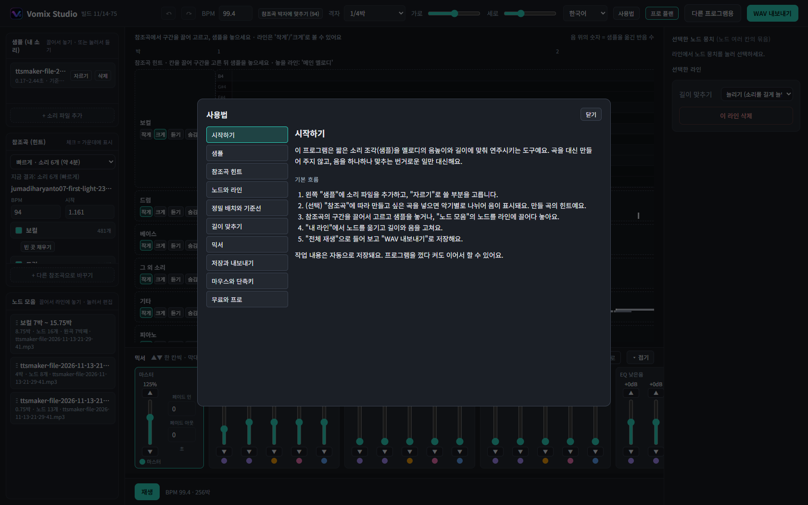
*프로그램 안의 사용법 창*

### 설치
- [Releases](../../releases)에서 설치 파일을 받아 실행해요. 파이썬은 따로 필요 없고, 관리자 권한도 필요 없어요.
- 코드 서명이 없어서 Windows가 "PC 보호" 화면을 띄울 수 있어요. **추가 정보 → 실행**을 누르세요.
- 프로그램 창은 Microsoft Edge로 열려요. 창을 닫으면 프로그램도 같이 꺼져요.
- 프로젝트는 `%LOCALAPPDATA%\VomixStudio\data`에 저장돼요(개발 실행은 `app/data`).

### 기본 흐름
1. 왼쪽 **샘플**에 소리 파일을 넣고, **자르기**로 쓸 부분을 골라요.
2. (선택) **참조곡**에 만들고 싶은 곡을 넣어요. 악기별로 나뉘어 음이 표시돼요.
3. 참조곡의 구간을 끌어서 고르고 샘플을 놓거나, **노드 모음**의 노드를 라인에 끌어다 놓아요.
4. **내 라인**에서 노드를 옮기고 길이와 음을 고쳐요.
5. **전체 재생**으로 듣고 **WAV 내보내기**로 저장해요.

작업 내용은 자동으로 저장돼요. 껐다 켜도 이어서 할 수 있어요.

---

## 2. 화면 구성

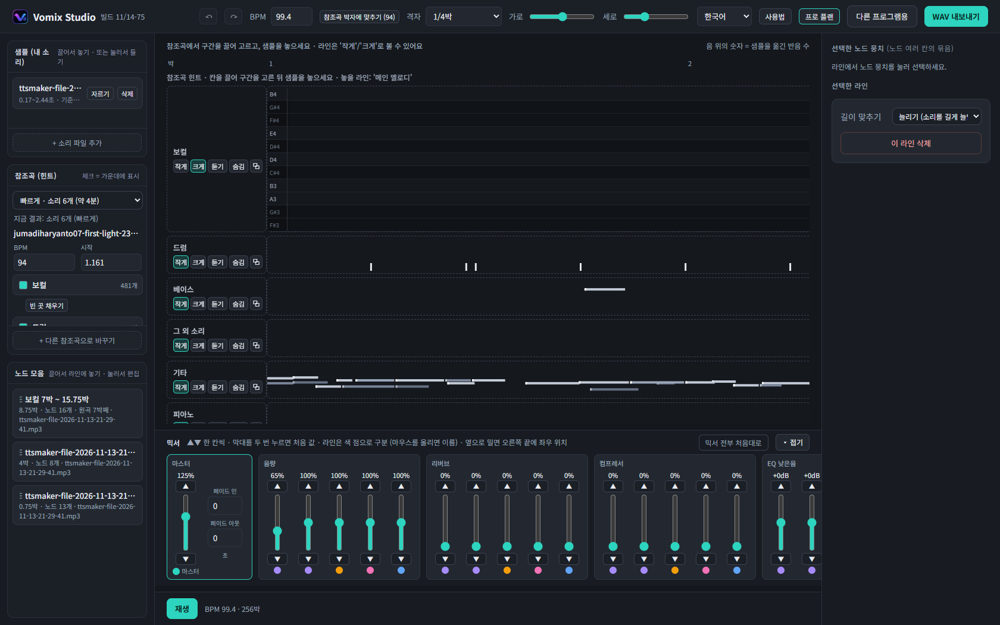
*전체 화면: 왼쪽 샘플·참조곡·노드 모음, 가운데 타임라인, 오른쪽 카드, 아래 믹서*

| 영역 | 설명 |
|---|---|
| 위쪽 막대 | 되돌리기/다시 하기, 격자, 가로·세로 크기, 언어, 플랜, 사용법 |
| 왼쪽 | **샘플**, **참조곡**, **노드 모음** |
| 가운데 | 박 눈금자, 참조곡 레인, **내 라인** 타임라인 |
| 오른쪽 | 선택한 라인·노드 뭉치·노드의 카드, **세로 기준선** 카드 |
| 아래 | 믹서(접을 수 있어요) |

- 위쪽 **격자**는 구간 선택, 이동, 길이 조절의 최소 단위예요. "자유"를 고르면 격자 없이 움직여요.
- 언어는 한국어/English 중에서 골라요(처음에는 브라우저 언어를 따라요).

---

## 3. 샘플

**소리 파일 추가**로 mp3, wav 같은 파일을 넣어요. 파일 이름이 샘플 이름이에요.

### 자르기
- **자르기**

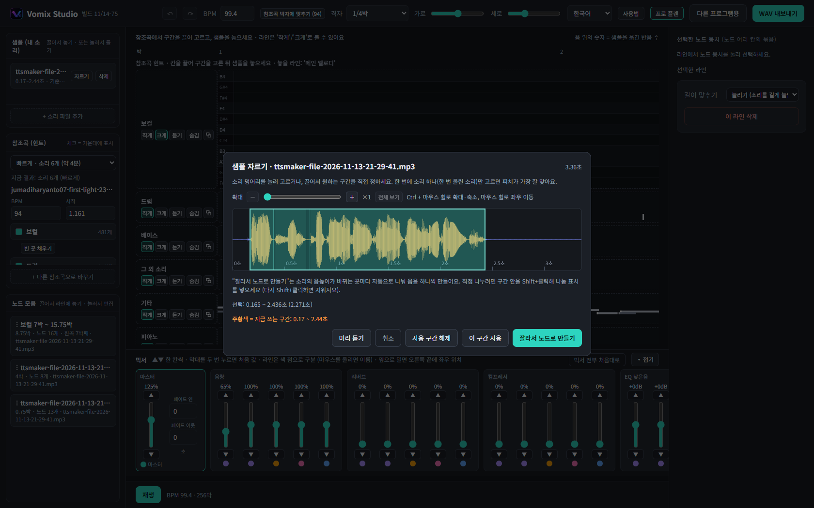
*샘플 자르기 창*
를 누르면 소리 모양이 나와요. 소리 덩어리를 눌러 고르거나 끌어서 구간을 정해요.
- 한 번에 소리 하나(한 번 울린 소리)만 고르면 음높이가 가장 잘 맞아요.
- **이 구간 사용**: 그 샘플의 쓸 구간을 정해요(파형에서 주황색). **사용 구간 해제**로 처음 상태로 돌아가요.
- **잘라서 노드로 만들기**: 잘라낸 소리를 바로 노드 모음에 넣어요. 소리의 음높이가 바뀌는 곳마다 자동으로 나뉘어 음이 하나씩 생겨요. 직접 나누려면 구간 안을 **Shift+클릭**해 나눔 표시를 넣어요.
- 노드는 자기 구간을 따로 기억해서, 샘플의 쓰는 구간을 바꿔도 변하지 않아요.

### 기준음
샘플의 기준음(처음 소리의 높이)은 자동으로 찾아요. 다른 음높이는 이 음을 기준으로 만들어져요. 음높이를 찾지 못한 소리(짧은 말소리, 타격음)는 라(A3)를 기준으로 소리를 빠르게/느리게 해서 음을 맞춰요.

### 음높이 곡선 편집

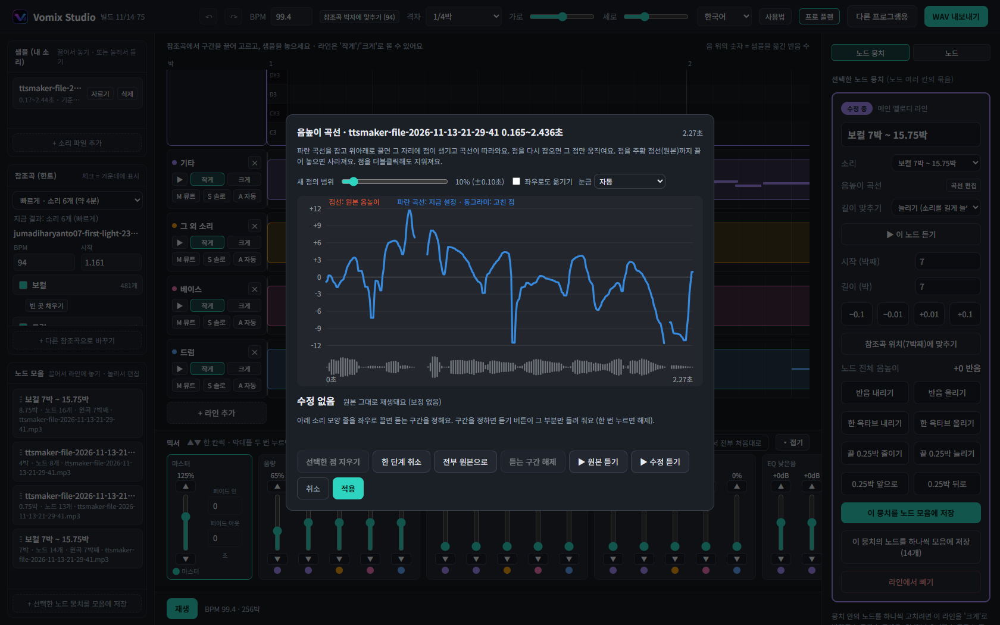
*음높이 곡선 편집 창*

소리 하나의 음높이 흐름을 곡선으로 고쳐요.
- 노드 뭉치 카드의 **음높이 곡선 → 곡선 편집**(노드 모음의 편집 창에도 있어요)에서 열어요.
- 곡선을 잡고 위아래로 끌면 점이 생기고 주변이 부드럽게 따라와요. 점을 다시 잡아 옮기거나 원본 선까지 끌어 놓아 지워요.
- **눈금**을 ±24반음으로 바꾸면 두 옥타브까지 움직여요. 점의 범위는 슬라이더나 마우스 휠로 바꿔요.
- 아래 소리 모양 줄을 좌우로 끌어 듣는 구간을 정하고 **구간 듣기**로 확인해요.
- 곡선은 **그 소리에 저장**돼서 같은 소리를 쓰는 모든 노드에 적용돼요.

---

## 4. 참조곡 분석

참조곡은 만들 곡의 모델이에요. 곡을 악기별 소리로 나누고 각 소리에서 음을 뽑아 보여 줘요. 음은 힌트일 뿐이고 어떻게 쓸지는 직접 정해요.

### 분리 정밀도
| | 소리 개수 | 걸리는 시간 | 플랜 |
|---|---|---|---|
| 빠르게 | 6개 | 약 4분 | 무료/Pro |
| 정밀하게 | 최대 53개 | 곡 길이의 약 11배 | **Pro** |

- 이미 넣은 곡도 **다시 분석**으로 다른 방식으로 나눌 수 있어요. 끝날 때까지 지금 결과는 그대로예요.
- 분석 중에는 프로그램을 닫거나 컴퓨터를 끄지 마세요.

### 레인 보기
- 레인 이름 옆 **작게/크게**로 막대 모양과 피아노 롤 모양을 바꿔요.
- **듣기**로 그 악기 소리만 들어요. 소리가 큰 레인 8개만 먼저 켜져 있어요.
- 아주 조용한 소리에서 잘못 뽑힌 음은 자동으로 빼요.

### 빈 곳 채우기

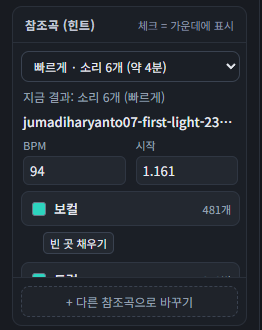
*참조곡 레인 목록과 빈 곳 채우기 버튼*

레인마다 **빈 곳 채우기** 버튼이 있어요. 음을 못 찾은 자리에 소리가 나고 있으면 소리의 음높이 선을 따라 음을 더 뽑아요(1분 곡 기준 20초쯤). 한 번 채운 뒤에는 **빈 곳 다시 채우기**로 바뀌어요.

### 음 하나 고르기
- 레인의 음을 누르면 그 음 하나만 선택돼요(같은 음이 이어져 있어도 따로).
- **이 음만 듣기**: 겹치는 다른 음을 줄여서 그 음만 들려줘요. **녹음 그대로 듣기**: 겹친 소리까지 들려요. **음높이만 듣기**: 단순한 소리로 높이만 확인해요.
- 같은 시간에 다른 음이 울리면 알려 주고, 옥타브나 5도 관계라 떼어 내기 어려운 음에는 **분리 어려움**이 붙어요.
- 녹음에서는 여러 번 나는데 한 덩어리로 분석된 음은 경고로 알려 줘요.

### 레인 통째로 가져오기
레인 이름 옆 **⧉** 버튼을 누르면 그 레인의 음 전체가 내 라인의 새 라인으로 복사돼요. 정밀 분석으로 나눈 베이스 레인을 통째로 가져올 때 좋아요. 섞인 레인은 구간 위쪽의 **섞인 레인은 멜로디 후보 한 줄만** 옵션에 따라 멜로디 후보만, 또는 모든 음을 가져와요.

---

## 5. 노드 만들기

**노드**는 "어떤 음들을 어떤 길이로 연주할지"를 담은 칸이고, **노드 뭉치**는 그 칸들의 덩어리예요. **라인**은 노드 뭉치를 놓는 한 줄(메인 멜로디, 베이스 등)이에요.

### 참조곡 구간으로 만들기
1. 참조곡 레인에서 구간을 끌어 골라요.
2. 왼쪽 샘플을 그 구간에 끌어다 놓아요(샘플을 눌러 "든" 뒤 구간을 눌러도 돼요).
3. **어디에 넣을까요?** 창에서 내 라인 하나를 고르면 그 라인에 놓이고 노드 모음에도 자동 저장돼요. **노드 모음에만 넣기**는 라인에 놓지 않고 모음에만 넣어요.

참조곡에서 가져온 음은 참조곡과 같은 높이예요. 샘플의 기준음에서 많이 멀면 소리가 부자연스러울 수 있어요.

### 여러 소리가 든 샘플
참조곡 구간에 놓으면 잘라낸 소리 전체를 구간에 맞춰 펴고 조각을 멜로디 음에 순서대로 배정해요. 음이 조각보다 많으면 조각 하나가 이어진 음 여러 개를, 조각이 음보다 많으면 음 하나가 이어진 조각 여러 개를 맡아요.

### 말 박자 맞추기 (보컬, 랩, 대사)
"어디에 넣을까요?" 창의 **말 박자에 맞추기**를 켜면 선택 구간의 말이 시작되는 자리(음절)마다 샘플의 소리 조각이 하나씩 놓여요. 음높이는 샘플 그대로고 말의 박자만 따라 해요. 조각이 모자라면 처음부터 다시 쓰고, 설정은 기억돼요. 단일 음만 고른 경우에는 적용되지 않아요.

### 노드 모음
- 만든 뭉치를 저장해 두고 라인에 끌어다 놓거나, 눌러서 **선택 라인에 추가**해요.
- 뭉치를 누르면 나오는 **노드 편집**(또는 두 번 누르기)으로 편집 창을 열어요. 창에서 노드를 골라 음높이, 위치, 길이를 고치거나 지우고, **노드 모음에 따로 저장**으로 새 항목을 만들어요.
- 라인의 빈 곳에 놓으면 그 위치에, 라인 이름 칸에 놓으면 그 라인의 첫 빈자리에 놓여요. 라인이 화면 밖이면 끈 채로 타임라인 아래 가장자리로 가져가면 스크롤돼요.

### 직접 추가
라인의 빈 곳을 **두 번 누르면** 노드가 추가돼요.

### 라인 관리
**+ 라인 추가**로 늘리고, 라인 이름 옆 ✕(또는 오른쪽 **이 라인 삭제**)로 지워요. 라인은 최소 1개가 있어야 해요. 이름은 직접 고쳐요.

---

## 6. 노드 편집

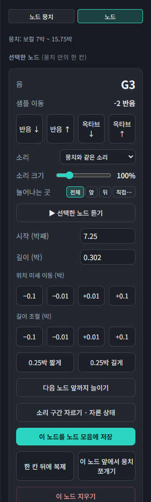
*노드 카드: 음, 소리, 늘어나는 곳, 위치·길이, 자르기*

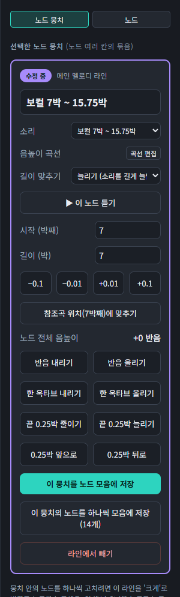
*노드 뭉치 카드: 곡선 편집, 모음에 저장, 하나씩 저장*

- 뭉치를 끌어 옮겨요(다른 라인으로도).
- 뭉치를 선택하면 뭉치 전체(위치, 길이, 전체 음높이)를, 라인을 **크게**로 바꾸고 노드를 누르면 그 한 칸만 조정해요. Shift/Ctrl로 여러 개를 골라 함께 고칠 수도 있어요.
- 오른쪽 위 **노드 뭉치 / 노드** 탭이 지금 무엇을 고치는지 보여 줘요.
- 노드 카드에서 이름, **소리**, 길이, 음높이(반음/옥타브), 소리 크기를 바꿔요. 새 노드는 그 라인에서 마지막으로 고른 소리로 시작해요.
- 참조곡에서 온 노드는 **참조곡의 원래 소리**를 고르면 샘플 대신 그 레인의 실제 연주가 나와요.
- **이 음 앞에서 노드 쪼개기**, **이 음 지우기**, 복제 버튼이 있어요.
- 한 번 손으로 고친 뭉치는 끝을 줄이거나 늘려도 참조곡에서 음을 다시 가져오지 않고 고친 음을 그대로 둬요.
- **노드 모음에 저장**으로 뭉치나 노드를 따로 저장해요(노드 하나는 한 칸짜리 뭉치). 뭉치 카드의 **하나씩 모음에 저장**은 안의 모든 노드를 각각 저장해요.
- 노드 이름은 선택하거나 마우스를 올렸을 때만 보여요. 선택한 노드는 노란 테두리로 보여요.

---

## 7. 정밀 배치와 기준선

### 노드 위치를 정확히
- 오른쪽 카드의 **시작(박째)**, **길이(박)**에 숫자를 직접 넣어요(0.448박 같은 값도 돼요).
- −0.1, −0.01, +0.01, +0.1 버튼으로 조금씩 움직여요.
- 참조곡에서 만든 노드는 **참조곡 위치에 맞추기**로 원래 위치에 되돌려요.
- 격자를 "자유"로 하거나 끌 때 **Alt**를 누르면 격자 없이 움직여요.

### 세로 기준선 (여러 개, 색 구분)

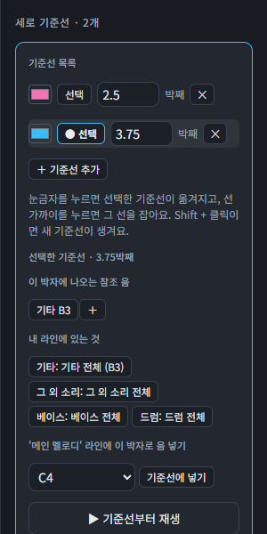
*세로 기준선 카드: 색 구분된 여러 기준선*

여러 라인이 같은 박자에 놓이는지 맞춰 볼 때 써요.
- 위쪽 **박 눈금자**를 누르거나 끌면 색 있는 세로선이 생겨요. **Shift+클릭**으로 더 만들어요. 끌 때 Alt는 격자 없이 놓기예요.
- 오른쪽 **세로 기준선** 카드에서 선마다 색을 바꾸고, 위치(박째)를 입력하고, 지워요.
- 선택한 기준선의 박자에 나오는 참조 음과 내 라인의 음이 카드에 나와요. **＋**로 참조 음을 같은 음으로 내 라인에 넣거나, 음을 골라 **기준선에 넣기**로 직접 넣어요.
- **기준선부터 재생**으로 그 위치부터 들어요.
- 노드를 끌거나 놓을 때 기준선 근처에서 자석처럼 붙어요.

---

## 8. 길이 맞추기와 늘어나는 곳

### 긴 음을 채우는 방법
샘플보다 긴 음을 어떻게 채울지는 라인 전체에 정하고, 노드마다 따로 바꿀 수도 있어요. **라인 설정 따르기**를 고르면 라인 방식을 따라가요.

| 방식 | 설명 |
|---|---|
| 늘리기 | 소리를 음 길이만큼 늘려요. 목소리처럼 길게 끌 수 있는 소리에 좋아요. |
| 반복하기 | 음이 샘플보다 훨씬 길면(1.5배 이상) 샘플을 되풀이해서 채워요. 짧게 끝나는 소리에 좋아요. |
| 원래 속도로 | 늘이거나 줄이지 않고 원래 속도로 재생해요. 소리가 흘러가며 그 시간의 음높이로 바뀌고, 끝나면 처음부터 이어가요. 음이 없는 곳은 조용해요. |

짧은 음은 어느 쪽이든 한 번만 소리 나요.

### 늘어나는 곳 (앞 / 뒤 / 전체 / 직접)
음이 소리보다 길 때 소리의 **어느 부분이 늘어날지** 정해요. "떴다 떴다 비행기"의 "떴다"를 "ㄸ~~~었다"처럼 앞을 늘이거나, "떴다아아아"처럼 뒤를 늘이는 식이에요. 노드 카드의 **늘어나는 곳** 칩을 써요.
- **전체**: 소리의 가장 안정된 모음 부분이 늘어나요(기본).
- **앞**: 음높이가 시작되는 곳이 늘어나요.
- **뒤**: 음높이가 끝나는 곳이 늘어나요.
- **직접…**: **늘일 곳 고르기** 창을 열어요.

### 늘일 곳 고르기 창

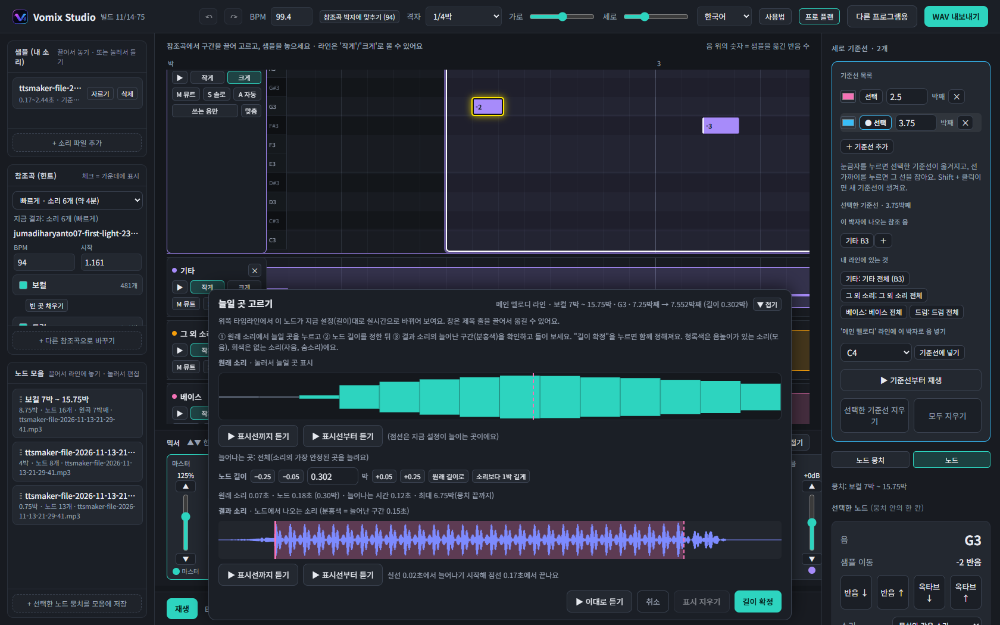
*늘일 곳 고르기 창 (아래쪽에 떠서 위의 라인이 실시간으로 바뀌어요)*

1. **원래 소리**의 파형에서 늘일 곳을 눌러요(청록색은 음높이가 있는 소리=모음, 회색은 없는 소리=자음·숨소리).
2. **노드 길이**를 정해요. **원래 길이로**, **소리보다 1박 길게** 버튼으로 빠르게 맞춰요.
3. **결과 소리**에서 늘어난 구간(분홍색)을 확인하고 **표시선까지/표시선부터 듣기**로 들어 봐요(원래 소리와 결과 소리 모두).
4. **길이 확정**으로 늘일 곳과 길이를 함께 정해요. **취소**하면 아무것도 바뀌지 않아요.

창은 화면 아래에 떠서 위쪽 타임라인을 가리지 않고, 설정한 길이가 **실제 라인에 실시간으로** 보여요(확정 전에는 저장되지 않아요). 제목 줄을 끌어 옮길 수 있고(몇 픽셀 이내의 흔들림은 무시해요), **▼ 접기**로 제목 줄만 남겨 타임라인을 자유롭게 볼 수 있어요. 접은 상태에서도 **길이 확정/취소**를 쓸 수 있어요.

---

## 9. 소리 구간 자르기와 나누기

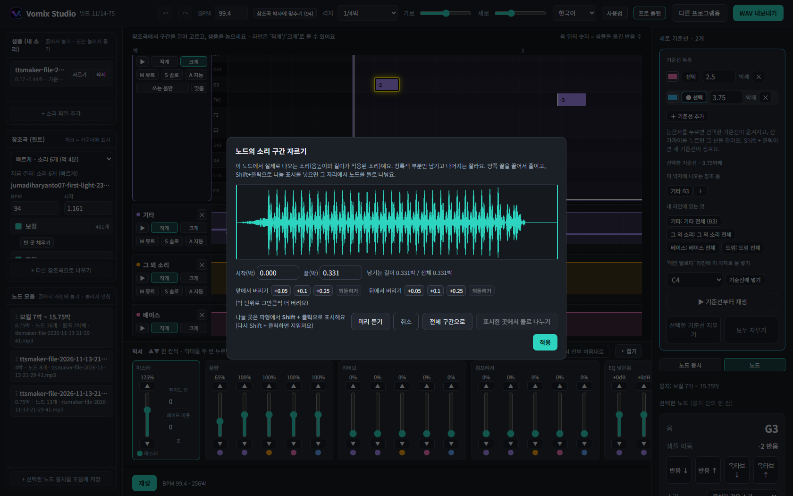
*노드의 소리 구간 자르기 창*

노드 카드의 **소리 구간 자르기**는 **노드에서 실제로 나오는 소리**(음높이와 길이가 적용된 소리)를 기준으로 해요. 원본 샘플 기준이 아니에요.

- 파형에서 청록색 부분만 남고 나머지는 잘려요. **양쪽 끝을 끌어서** 줄여요.
- **시작(박)/끝(박)** 숫자로도 정해요. **앞에서 버리기 / 뒤에서 버리기**는 박 단위로 그만큼씩 더 버려요(각각 **되돌리기** 가능). **전체 구간으로**는 처음 상태로 돌려요.
- **Shift+클릭**으로 파형에 **나눔 표시**를 넣어요(다시 Shift+클릭하면 지워져요). 한 번 클릭만으로는 표시되지 않아요.
- **표시한 곳에서 둘로 나누기**: 그 자리에서 노드를 둘로 나눠요. 나뉜 각 조각은 자기 소리 구간을 기억하고 **길이를 늘일 수 있어요**(늘리면 잘린 소리가 이어서 늘어나요).
- **미리 듣기**로 확인하고 **적용**해요.

---

## 10. 믹서

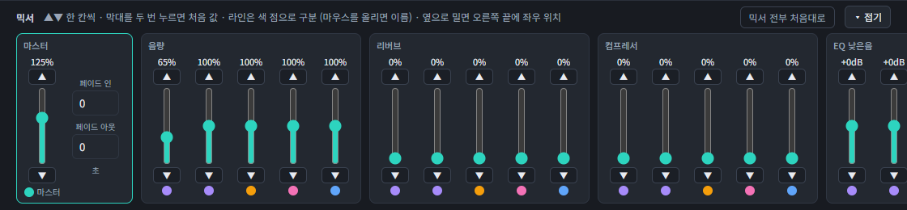
*믹서*

여러 라인을 한 곡으로 합칠 때의 소리를 다듬어요. 재생 중에 바꾸면 잠시 뒤 바뀐 소리로 이어서 들려요.

- **라인 머리**: **M**(뮤트)은 그 라인을 끄고, **S**(솔로)는 솔로가 켜진 라인만 들려요(여러 라인 가능). 라인 옆 ▶로 한 라인만 들을 때는 뮤트/솔로와 상관없이 그 라인이 나와요.
- **아래 믹서**: 라인마다 세로 막대(페이더)가 있고 항목별로 묶여 있어요. 막대를 끌거나 ▲▼로 한 칸씩 움직이고, 두 번 누르면 처음 값으로 돌아가요.
  - **음량** 0~200% · **리버브**(울림) · **컴프레서**(큰 소리와 작은 소리의 차이를 줄임) · **EQ**(낮은음/중간음/높은음 ±12dB) · **좌우 위치**(믹서를 옆으로 밀면 맨 끝에 있어요).
- **마스터**(맨 왼쪽): 마스터 음량(100% 초과 시 부드럽게 눌러 깨짐을 줄임), **페이드 인/아웃**(초). 라인을 합친 뒤 가장 큰 소리를 자동으로 맞추고 마스터 음량을 적용하므로, 한 라인을 키우면 나머지는 상대적으로 작아져요.
- **믹서 전부 처음대로**로 되돌리고, **접기**로 작업 공간을 넓혀요.

---

## 11. 저장, 되돌리기, 내보내기

### 자동 저장
작업은 자동 저장돼요. 컴퓨터를 옮길 때는 데이터 폴더(`%LOCALAPPDATA%\VomixStudio\data`)를 복사해요.

### 되돌리기 / 다시 하기

*위쪽 막대: 되돌리기·다시 하기 버튼은 왼쪽에 있어요*

위쪽 막대의 되돌리기·다시 하기 버튼 또는 **Ctrl+Z / Ctrl+Y**로 노드·라인 수정을 한 단계씩 되돌리고 다시 해요. 되돌리면 "한 단계 되돌렸어요"라고 알려 줘요.

### WAV 내보내기
모든 라인을 합친 스테레오 WAV 파일을 만들어요.

### 다른 프로그램용 내보내기

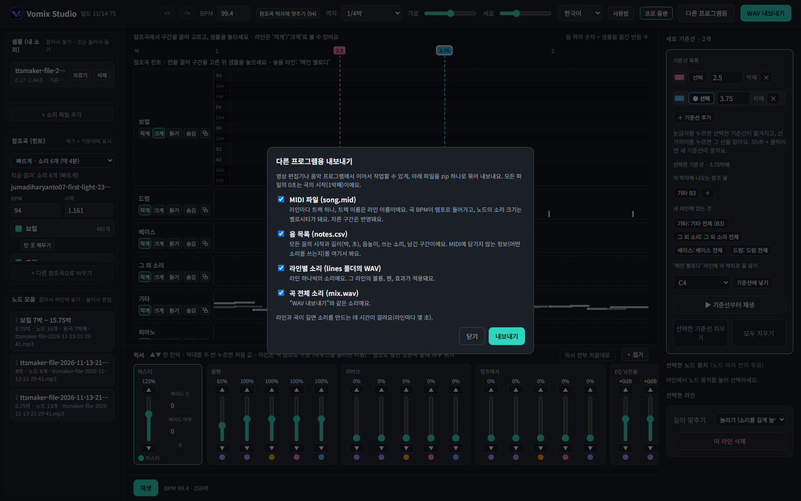
*다른 프로그램용 내보내기 창*

영상 편집기나 음악 프로그램에서 이어서 작업할 수 있게 **zip 하나**로 묶어 내보내요. 모든 파일의 0초는 곡의 시작(1박째)이에요. 항목은 골라서 내보내요.

| 파일 | 내용 |
|---|---|
| `song.mid` | MIDI. 라인마다 트랙 하나(트랙 이름 = 라인 이름), 곡 BPM이 템포, 노드의 소리 크기가 벨로시티. 자른 구간이 반영돼요. |
| `notes.csv` | 모든 음의 시작·길이(박, 초), 음높이, 쓰는 소리, 남긴 구간. MIDI에 안 담기는 "어떤 소리를 쓰는지"를 여기서 봐요. |
| `lines/` | 라인 하나씩의 WAV. 그 라인의 볼륨, 팬, 효과가 적용돼요. |
| `mix.wav` | "WAV 내보내기"와 같은 곡 전체 소리. |
| `README.txt` | 파일 설명(한/영/일). |

라인과 곡이 길면 소리를 만드는 데 시간이 걸려요(라인마다 몇 초). 영상 편집기에서는 `lines/`의 WAV를 같은 0초에 맞춰 올리고 `notes.csv`를 보며 컷을 맞추면 돼요.

---

## 12. 마우스와 단축키

| 조작 | 동작 |
|---|---|
| Ctrl + 마우스 휠 | 타임라인 가로 크기 |
| Alt + 마우스 휠 | 모든 레인과 라인의 세로 크기 |
| Ctrl+Z / Ctrl+Y | 되돌리기 / 다시 하기 |
| Esc | 선택 해제(빈 곳을 눌러도 풀려요) |
| Shift/Ctrl + 클릭 | 여러 개 선택 |
| 박 눈금자 클릭·끌기 | 기준선 만들기 / 옮기기 |
| 박 눈금자 Shift+클릭 | 기준선 더 만들기 |
| 끌 때 Alt | 격자 없이 놓기 |
| 라인 빈 곳 두 번 누르기 | 음(노드) 추가 |
| 파형에서 Shift+클릭 | 나눔 표시(자르기 창, 샘플 자르기) |

---

## 13. 무료와 Pro

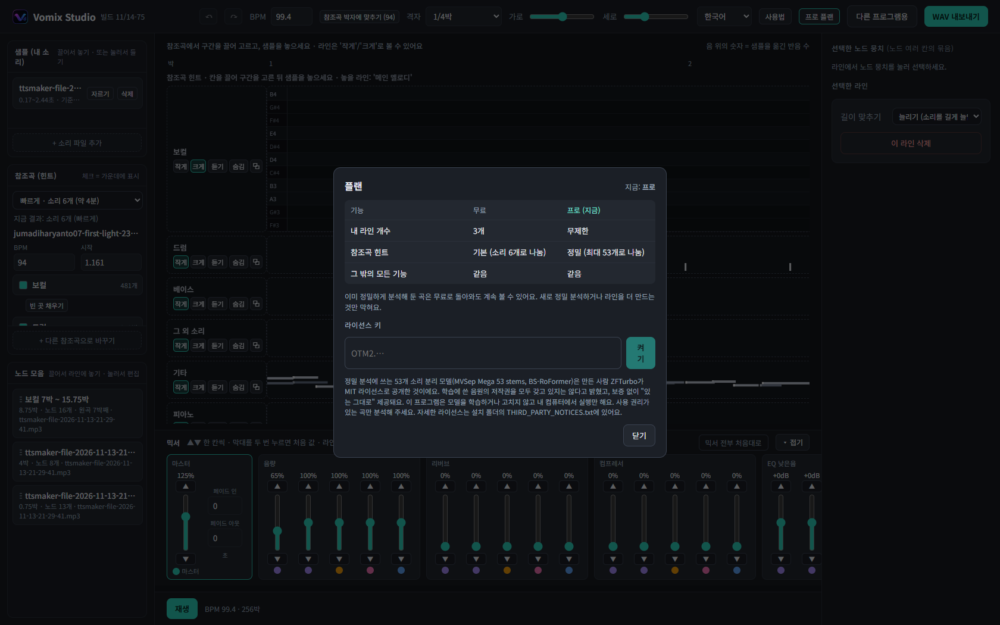
*플랜 창*

| | 무료 | Pro |
|---|---|---|
| 내 라인 | 3개 | 무제한 |
| 참조곡 분석 | 빠르게(6개 소리) | 빠르게 + 정밀하게(최대 53개) |
| 믹서 / 내보내기 | ✔ | ✔ |

위쪽 **플랜** 버튼에서 차이를 보고 라이선스 키를 넣어요. 무료로 돌아와도 이미 정밀 분석한 곡은 계속 볼 수 있어요. 키를 받는 방법은 [README](README.md), 조건은 [PRO-TERMS.md](PRO-TERMS.md)를 보세요.

---

## 14. 자주 묻는 질문

- **소리가 부자연스러워요.** 샘플의 기준음에서 너무 멀리 옮기지 마세요. 한 번에 소리 하나만 자른 샘플이 가장 잘 맞아요. 길게 끌 소리라면 길이 맞추기를 **늘리기**로, 짧게 끝나는 소리라면 **반복하기**로 해 보세요.
- **음이 빠져 있어요.** 레인의 **빈 곳 채우기**를 눌러 보세요. 겹친 소리가 많으면 **정밀하게**(Pro)로 다시 분석하는 게 나아요.
- **창을 닫았는데 프로그램이 꺼졌어요.** 설치본은 창을 닫으면 프로그램도 꺼지는 게 정상이에요. 작업은 자동 저장돼요.
- **참조곡을 넣어도 되나요?** 사용 권리가 있는 곡만 분석해 주세요. 참조곡과 샘플의 저작권 책임은 사용자에게 있어요.
- **문의**: vomixstudio.contact@gmail.com
