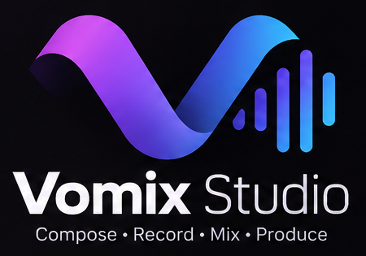

# Vomix Studio

짧은 소리 조각(샘플)을 멜로디의 음높이와 길이에 맞춰 연주시키는 **음MAD / YTPMV 제작 도구**예요. 내 컴퓨터에서만 돌아가요.

> 곡을 대신 만들어 주는 도구가 아니에요. 참조곡의 음을 힌트로 보여 주고, 음을 하나하나 맞추는 반복 작업만 대신해요.

## 할 수 있는 일
- **참조곡 분석**: 곡을 악기별로 나누고 음 위치를 힌트로 보여 줘요 (빠르게 6개 소리 / 정밀하게 최대 53개 소리).
- **노드로 만들기**: 참조곡 구간을 골라 샘플을 끌어다 놓으면 그 구간의 음으로 "노드 뭉치"가 만들어져요. 노드마다 음높이·길이를 따로 고칠 수 있어요.
- **노드 모음**: 만든 뭉치를 저장해 두고 라인에 끌어다 놓아요.
- **여러 라인과 믹서**: 라인별 볼륨, 좌우 위치, 음소거/솔로, EQ, 컴프레서, 리버브, 마스터 볼륨.
- **WAV 내보내기**: 모든 라인을 합친 스테레오 WAV.
- **한국어 / English**: 위쪽의 언어 선택으로 화면 언어를 바꿀 수 있어요(처음에는 브라우저 언어를 따라요).

## 설치 (Windows 10 / 11)
[Releases](../../releases)에서 설치 파일을 받아 실행해요. 파이썬은 따로 설치하지 않아도 돼요. 현재 사용자용으로 설치되며 관리자 권한은 필요 없어요.
- 코드 서명이 없어서 Windows가 "PC 보호" 화면을 띄울 수 있어요. "추가 정보 → 실행"을 눌러 주세요.
- 프로그램 창은 Microsoft Edge로 열려요.
- 프로젝트는 `%LOCALAPPDATA%\VomixStudio`에 저장돼요.

## 플랜
| | 무료 | Pro |
|---|---|---|
| 내 라인 | 3개 | 무제한 |
| 참조곡 분석 | 빠르게(6개 소리) | 빠르게 + **정밀하게(최대 53개 소리)** |
| 믹서 / WAV 내보내기 | ✔ | ✔ |

Pro는 라이선스 키로 켜요. 자세한 조건은 [PRO-TERMS.md](PRO-TERMS.md)를 보세요.

## 후원하고 Pro 키 받기
개인이 만드는 프로그램이에요. 후원은 이 프로그램을 계속 고치는 데 쓰여요.
- 후원해 주시면 **약 3개월짜리 Pro 키**를 드려요.
- 쓸 만한 **피드백**(재현되는 버그, 구체적인 개선 제안)을 주시면 **약 1개월짜리 Pro 키**를 드려요.
- 신청은 [이슈 양식](../../issues/new?template=pro-key-request.yml)으로 해 주세요. **후원한 화면의 스크린샷과 GitHub 사용자 이름**이면 돼요(피드백이면 해당 이슈 링크). 스크린샷은 공개 글에 올라가니 카드·계좌·메일 주소는 가리고 올려 주세요. 키는 이슈에 공개하지 않고 따로 전달해요. 기간은 대략이고, 제가 확인한 뒤 정해요.
- 후원 방법: *(GitHub Sponsors 등 개설 후 여기에 링크를 적어요)*
- 문의: vomixstudio.contact@gmail.com

## 직접 실행하기 (개발용)
파이썬 3.10과 가상환경이 필요해요. 주요 패키지: torch(CPU), demucs, basic-pitch, librosa, pyworld, fastapi, uvicorn, scipy, soundfile.
`run.bat`(또는 `python launcher.py`)로 실행해요. 정밀 분석 모델 파일(`models/mega53`, 약 1.3GB)은 이 저장소에 들어 있지 않아요.

## 라이선스
- 저작권자: MJ, Vomix Studio 제작자 ([@mjkim1128](https://github.com/mjkim1128))
- 소스 코드: [PolyForm Noncommercial 1.0.0](LICENSE) — 비상업적 사용만 허락돼요. Pro 관련 조건은 [PRO-TERMS.md](PRO-TERMS.md).
- 정밀 분석 모델(MVSep Mega 53 stems)은 ZFTurbo가 MIT로 공개한 것이에요. 학습 음원의 저작권을 모두 갖고 있지는 않다고 밝혔고 보증 없이 제공돼요. 구성 요소별 고지는 [packaging/THIRD_PARTY_NOTICES.txt](packaging/THIRD_PARTY_NOTICES.txt).
- **사용 권리가 있는 곡만 분석해 주세요.** 참조곡과 샘플의 저작권 책임은 사용자에게 있어요.

---

# English summary
Vomix Studio is a local Windows tool for making otomad / YTPMV: short samples are fitted to the notes of a melody, with hints taken from a reference song. It does not compose for you. The interface is available in Korean and English. Free plan: 3 lines. Pro: unlimited lines and the precise 53-stem analysis. Source code is under the PolyForm Noncommercial License 1.0.0 (see `LICENSE`, `PRO-TERMS.md`). Sponsors get about 3 months of Pro, useful feedback about 1 month — open a "Pro key request" issue. Contact: vomixstudio.contact@gmail.com
